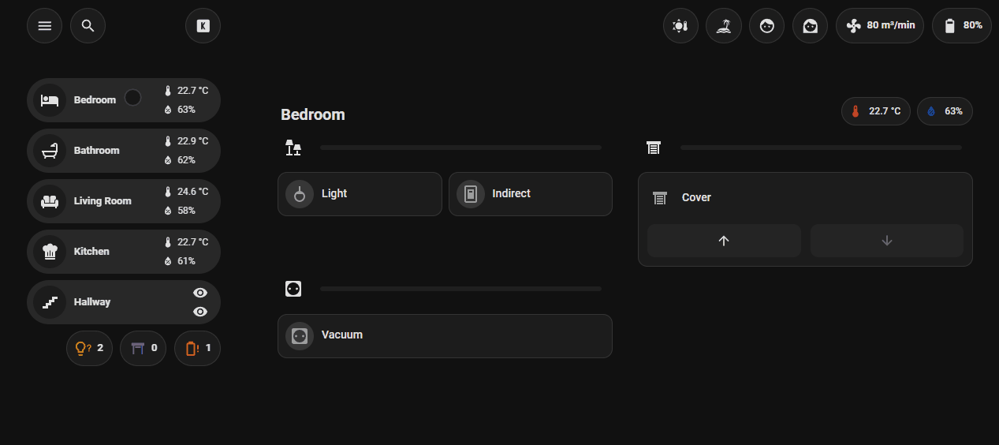
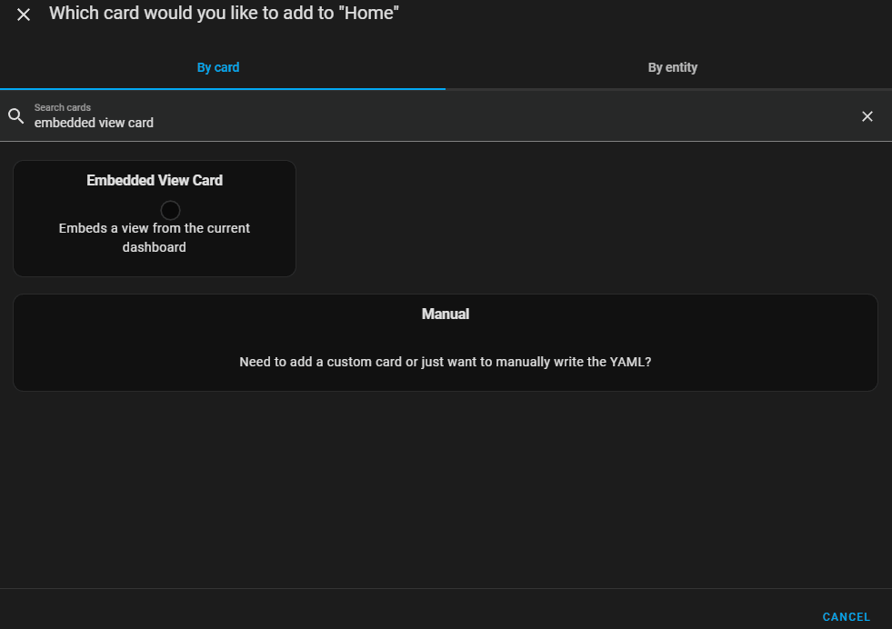

[](https://github.com/redkanoon/embedded-view-card/releases)
[](https://github.com/redkanoon/embedded-view-card/commits/main)
[](https://community.home-assistant.io/t/new-custom-card-embedded-view-card-embed-any-view-into-another/917306)
[](https://ko-fi.com/redkanoon)



# 🧩 Embedded View Card for Home Assistant

The **Embedded View Card** allows you to embed another Lovelace view directly into a card inside your current dashboard – or even across dashboards.  
It’s perfect for modular layouts, reusable components, and dynamic navigation.

---

## 💡 Why this card?
Managing complex dashboards with many pages or modular views can become difficult and repetitive.  
This card was built to make it easier to design reusable view components that can be visually customized and referenced from anywhere.

Instead of copying entire layouts into every view, you can now embed them once and reuse them multiple times.  
Compared to using iframes, this approach is faster, more integrated, and avoids the delay of loading a separate web page.

This card was built to feel like a native part of Home Assistant – rendering views directly, without hacks or reloads.

---

## ⚡ Features

- Embed any view from the **current or another dashboard** – including the built-in dashboards (**Overview/`lovelace`**, **Home**, **Map**, **Energy**) and auto-generated / strategy dashboards (e.g. Areas)
- **Static mode**: pick dashboard + view directly
- **Dynamic mode**: use an entity (`input_text`) whose state is `dashboard/view`
- **Hash mode**: switch views based on the URL hash (`#climate`, `#lights`, etc.)
- **Strategy view support**: properly renders strategy-based views (home, areas, energy, …)
- **View themes**: the `theme` of the embedded view is applied
- **Hide card types** (`exclude_cards`) – e.g. avoid a duplicated navbar
- Loop guard: prevents self-embedding and recursive embedding chains (A → B → A)
- Optionally wrap content in `ha-card`
- **Bleed mode**: remove default padding with adjustable margins
- Editor UI with localized labels and previews
- Compatible with HACS for easy updates

---

## 📦 Installation

### Manual Installation

1. Download `embedded-view-card.js` into `config/www/`.
2. Add the following to your `configuration.yaml` resources:

```yaml
resources:
  - url: /local/embedded-view-card.js
    type: module
```

### HACS Installation

1. Open **HACS** → **⋮ Menu** → **Custom repositories**
2. Add the following repository as a **Dashboard** integration:

```
https://github.com/redkanoon/embedded-view-card
```

3. After adding, search for **Embedded View Card** and install it from HACS  
4. If not added automatically, add the following to your `configuration.yaml` resources:

```yaml
resources:
  - url: /hacsfiles/embedded-view-card/embedded-view-card.js
    type: module
```

---

## 🧰 Configuration Examples



### Static Mode – Fixed View

```yaml
type: custom:embedded-view-card
dashboard: dashboard-main
view: climate
ha_card: true
```

### Dynamic Mode – View from Entity

#### Helper (must exist)

```yaml
input_text:
  window_view:
    name: window_view
```

#### Card

```yaml
type: custom:embedded-view-card
mode: dynamic
target_entity: input_text.window_view
ha_card: false
```

#### Action (e.g. in a button card)

```yaml
tap_action:
  action: perform-action
  perform_action: input_text.set_value
  target:
    entity_id: input_text.window_view
  data:
    value: dashboard-rooms/kitchen
```

#### The following view must exist in your dashboard

```yaml
title: Kitchen
path: kitchen
type: sections
```

---

### Hash Mode – URL Hash Switching

```yaml
type: custom:embedded-view-card
mode: hash
default: climate
states:
  climate:
    view: climate
  lights:
    view: lights
  energy:
    dashboard: dashboard-main
    view: energy
```

#### Navigation buttons to switch views

```yaml
type: horizontal-stack
cards:
  - type: button
    name: Climate
    tap_action:
      action: navigate
      navigation_path: "#climate"
  - type: button
    name: Lights
    tap_action:
      action: navigate
      navigation_path: "#lights"
  - type: button
    name: Energy
    tap_action:
      action: navigate
      navigation_path: "#energy"
```

### Built-in dashboards

```yaml
# first view of the legacy default dashboard ("Overview")
type: custom:embedded-view-card
dashboard: lovelace
view: "0"
```

```yaml
# a view of the built-in Energy dashboard (or: home, map, any strategy dashboard)
type: custom:embedded-view-card
dashboard: energy
view: electricity      # energy: overview, electricity, gas, water, now
```

### Hide card types (e.g. a navbar that every view contains)

```yaml
type: custom:embedded-view-card
dashboard: dashboard-rooms
view: kitchen
exclude_cards:
  - custom:navbar-card
```

---

## ⚙️ Options

| Option             | Type     | Description                                           | Default |
|--------------------|----------|-------------------------------------------------------|---------|
| `mode`             | string   | `"static"`, `"dynamic"`, or `"hash"`                  | static  |
| `dashboard`        | string   | Dashboard path (static mode)                          | current |
| `view`             | string   | View path (static mode)                               | —       |
| `target_entity`    | entity   | Entity whose state provides `dashboard/view` (dynamic)| —       |
| `default`          | string   | Fallback hash value when no URL hash matches (hash)   | —       |
| `states`           | object   | Map of hash keys to `{dashboard, view}` configs (hash)| —       |
| `exclude_cards`    | list     | Card types to hide in the embedded view               | —       |
| `ha_card`          | boolean  | Whether to wrap content in a `ha-card`                | true    |
| `bleed`            | boolean  | Remove outer padding (only when `ha_card: false`)     | false   |
| `bleed_inline`     | number   | Inline padding override (px)                          | 16      |
| `bleed_block`      | number   | Block padding override (px)                           | 8       |

---

## ⚙️ Hash Mode `states` Structure

The `states` object maps URL hash keys (or path segments) to view configurations:

```yaml
states:
  climate:
    view: climate
  lights:
    view: lights
  energy:
    dashboard: dashboard-main
    view: energy
```

Each key (e.g., `climate`, `lights`) corresponds to a URL hash (`#climate`, `#lights`) or an extra path segment (`/dashboard/view/climate`). The value specifies which view to load, optionally from a different dashboard.

---

## 🖥️ Editor Support

- Dropdown selection of **all** dashboards (incl. Overview, Home, Map, Energy, strategy dashboards) and their views – also for the current dashboard
- Dynamic entity preview and format hints
- Localized labels (EN, DE, FR, ES, IT, NL, PL, …)

---

## 🧪 Developer Notes

- Uses internal components like `hui-root` and `hui-view`  
  *(subject to change by Home Assistant core)*
- **Strategy views**: properly detects and renders strategy-based views (e.g., `home`, `sections` strategies) by passing the `strategy` config to `hui-view`
- Shared, deduplicated cache of dashboard configs; invalidated on `lovelace_updated`, so embedded views follow edits of the source dashboard
- Strategy dashboards are generated with Home Assistant's own strategy (with fallbacks for built-in strategies not yet loaded in the browser)
- Smarter re-rendering (only when dashboard/view changes)
- Gracefully shows error messages when view is not found or misconfigured
- User visibility rules are respected for all embedded views

---

## 🚀 Contributing

Feel free to submit pull requests and suggestions.  
Ideas for improvement:

- Add mode "internal" where the embedded view could be changed with actions

---

## 📄 License

MIT License. See [LICENSE](./LICENSE) for full details.

---

## ☕ Support

Hey 👋 I love building this little something for Home Assistant!  
Being part of this amazing community is fun 💡  
If you like it, your support means a lot 🙏❤️

<a href="https://ko-fi.com/redkanoon" target="_blank">
  
</a>
